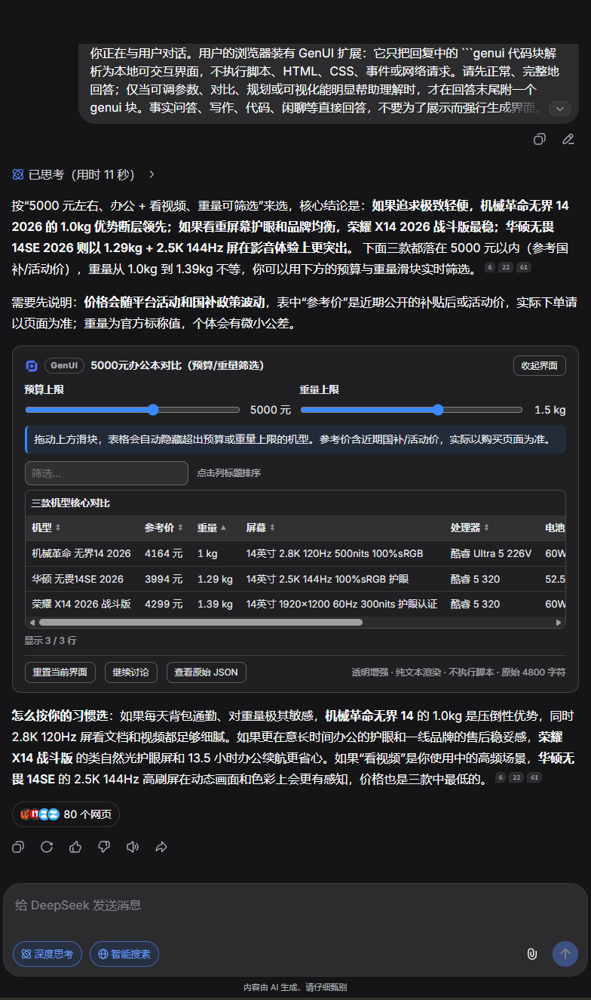
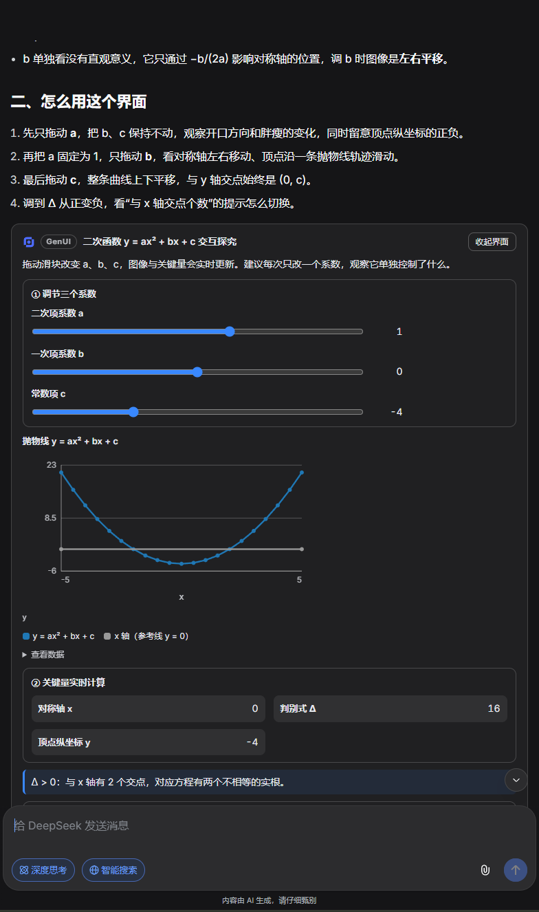
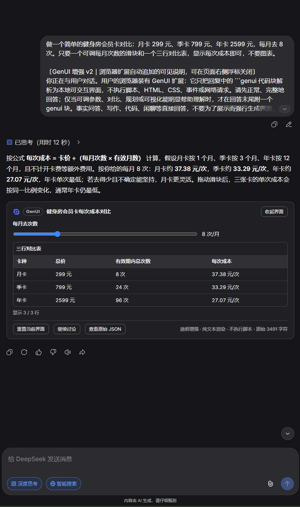
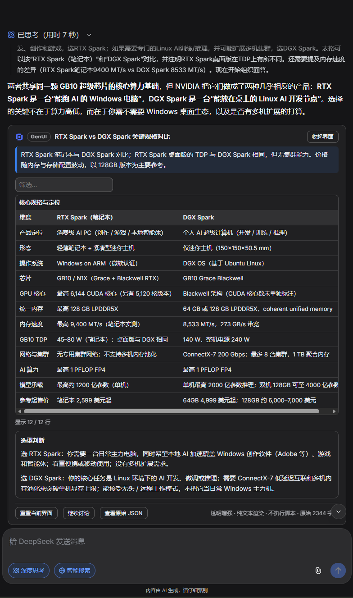

<p align="center">
  <picture>
    <source media="(prefers-color-scheme: dark)" srcset="assets/branding/responsive-node-v1/logo-horizontal-white.svg">
    
  </picture>
</p>

<p align="center"><strong>让 DeepSeek 的回答变成可以调整、计算和比较的交互界面。</strong></p>

<p align="center">
  
  <a href="https://github.com/deepseek-ai/deepseek-harness"></a>
</p>

<p align="center">
  
</p>

DeepSeek GenUI 是用于 [chat.deepseek.com](https://chat.deepseek.com) 的浏览器扩展。在原有文字回答中加入滑块、输入框、图表和表格，让你直接调整条件、查看结果，再把当前条件带回对话。

本项目为独立开发的第三方扩展，与 DeepSeek 官方无关。当前版本 **0.1.1**，支持在桌面 Edge、Chrome 中手动加载；尚未上架扩展商店。

## 功能

| 功能 | 你可以做什么 |
| --- | --- |
| 调整参数 | 用数值输入框、滑块和下拉选择器修改预算、次数、比例等条件 |
| 即时计算 | 参数变化后，本地同步更新合计、余额、单次成本等派生结果 |
| 图表联动 | 用柱状图、折线图和饼图查看变化，展开「查看数据」核对数值 |
| 表格比较 | 排序、搜索筛选，结合预算等条件缩小候选范围 |
| 条件说明 | 按当前参数显示提示，例如超支警告、无候选结果或公式退化说明 |
| 重置与收起 | 一键恢复初始参数、表格排序和筛选；收起界面时保留当前卡片状态 |
| 状态保持 | 生成新回答、同页重新挂载时保留已调整的参数与筛选；刷新或关闭标签页后回到初始值 |
| 依据与来源 | 界面标注用户提供、示例、估算、模型引用与本地计算结果；来源链接只作不可点击文本，统一标为「未核验」；缺失值不显示为 0 |
| 继续讨论 | 把参数、表格筛选、排序与选中项汇总成可预览、可修改的摘要，确认后填入输入框；保留已有草稿，由你决定是否发送 |
| 出错恢复 | 原始代码块下方区分等待、离屏补齐、需要修复或页面兼容；可展开原始内容并生成修复草稿 |
| 主题与开关 | 跟随站点明暗主题，随时关闭增强并恢复原始代码块 |

### 功能截图

以下为扩展在 DeepSeek 页面上的真实使用截图；数据由 AI 生成并标注为示例，不含账号、会话或其他个人信息。



*选购对比：按预算与重量筛选候选机型，用表格比较关键参数。*



*数学学习：拖动系数滑块，查看判别式、顶点与函数图像同步变化。*



*成本计算：调整每月次数，比较月卡、季卡、年卡的单次成本。*



*规格对比：用表格比较两款产品的定位、算力、内存和参考价。*

### 适合哪些问题

- **预算规划**：调整收入和支出，查看余额、分配比例与超支提醒。
- **选购比较**：按预算、重量等条件筛选商品，用表格比较候选方案。
- **数学学习**：拖动二次函数的参数，同步观察曲线、表格和判别式。
- **成本计算**：修改使用次数或月数，比较会员卡等方案的总价与单次成本。

普通事实问答、写作和闲聊仍以文字回答。界面由模型按问题生成，具体控件取决于回答内容。

## 怎么使用

1. 打开 DeepSeek，确认页面右侧显示「GenUI 已开启」。
2. 输入问题。停止输入约 **700ms** 后，扩展会在草稿末尾追加一份可见的界面生成说明；可在输入框或「查看增强说明」面板核对、修改。
3. 自行发送消息。模型回答中的合法 `genui` 代码块会渲染为交互卡片；必要时滚动到代码块位置，等待站点补齐内容。若格式不合法或页面暂不兼容，原代码块会保留并在下方说明原因；需要时点「生成修复请求」，检查写入的草稿后自行发送。若当前页找不到输入框且自动复制受限，可展开状态面板中的「手动复制完整修复请求」。
4. 调整卡片参数，查看实时结果；点击「继续讨论」会先展示当前参数、表格筛选/排序与选中项组成的摘要，可直接修改，确认后再填入输入框发送。

可以从这些问题开始：

> 做一个每月预算分配工具，让我调整各项支出并看到余额。

> 帮我做一个笔记本选购对比界面：预算 5000 元左右，主要办公和看视频，用表格比较 3 款，并让我按预算和重量筛选。

> 我想学习二次函数抛物线，帮我做一个可以调 a、b、c 的交互式学习界面。

扩展不会自动发送消息。关闭增强时会移除仍完整位于草稿末尾的自动说明，保留用户原文；修改过的说明不会被覆盖，手动删除说明后当前草稿不再自动追加。

## 安装

### 使用发布包

1. 从 [GitHub Releases v0.1.1](https://github.com/realhenrylan/chat-deepseek-genui/releases/tag/v0.1.1) 下载附件 [deepseek-genui-v0.1.1.zip](https://github.com/realhenrylan/chat-deepseek-genui/releases/download/v0.1.1/deepseek-genui-v0.1.1.zip)，解压为目录。
2. **Edge**：打开 `edge://extensions`，开启「开发人员模式」，点击「加载解压缩的扩展」，选择解压目录。
3. **Chrome**：打开 `chrome://extensions`，开启「开发者模式」，点击「加载已解压的扩展程序」，选择解压目录。
4. 打开或刷新 `https://chat.deepseek.com/`。

更新时重新加载扩展，并刷新已打开的 DeepSeek 标签页。发布页同时提供 SHA256 校验文件；发布包包含交互节点 Logo 与扩展图标，逐文件清单见 [验证报告](docs/phase8-verification.md)。

### 从源码构建

本仓库验证环境为 Windows 11、Node.js 24.15.0、npm 11.12.1，桌面 Edge / Chrome 156.x。

```bash
npm ci
npm run build
```

在扩展管理页加载生成的 `dist/` 目录即可。

### 自动打包与发布

工作流 [Build extension and prepare release draft](.github/workflows/build-release.yml) 在推送到 `main` 时，自动检查、测试、构建，并在 Actions 页面提供 ZIP 和 SHA256 校验文件（保留 30 天）。准备发布时，在 Actions 点 **Run workflow** 并填写最终插件版本号，工作流会按你填写的版本打包，只创建附带这两个文件的 **Release 草稿**。

**最终版本号由你填写，是否正式发布由你在草稿页点击 Publish release 决定**；普通推送和标签推送均不会自动正式发布。提示词的 `v2.8` 是独立版本，不是插件版本。具体步骤见[发布指南](docs/releasing.md)。

Release 草稿会带入 CHANGELOG 中本版的中文更新说明，按新增、更改、修复、移除等类别展示，并附 GitHub 自动生成的变更记录；发布前可在草稿页继续编辑。

当前 main 的 0.1.1 + Unreleased 已通过完整检查（39 个测试文件、473 项单测、类型检查、lint、构建与生产包校验）及 Edge/Chrome 默认端到端测试（24 通过、6 个真实 origin 用例按模式跳过）。历史真实网页验收与本轮自动化结果分别记录在 [分层报告](docs/phase8-verification.md)。

**卸载**：在扩展管理页移除扩展，本地开关设置随之删除；刷新或关闭已打开的 DeepSeek 标签页后，页面上的卡片、浮标和注入标记消失。

## 隐私与权限

- 仅在 `https://chat.deepseek.com/*` 运行，只申请 `storage` 权限，用于本机保存增强开关。
- 卡片计算在本地完成；页面内交互状态只存在于当前标签页内存，刷新或关闭标签页后消失，不写入本机存储，也不包含或上传聊天内容。
- 依据里的来源链接仅作为纯文本展示，扩展不会访问这些链接，也不会把资料标记为「已验证」。
- 默认说明和「继续讨论」摘要会写入可见草稿；摘要先在卡片内预览，可修改后再填入，你自行发送后由 DeepSeek 网站处理这条消息。
- 使用本地打包的 React 渲染，不执行模型生成的 HTML、CSS 或 JavaScript，不加载远程代码。

详见 [隐私说明](docs/privacy.md)。

## 使用边界

- 模型可能不生成界面或输出不合法格式；扩展会保留原始回答与代码块，并在块下方区分等待完整内容、离屏补齐、需要修复与页面暂不兼容，不强制转换。
- 卡片状态在页面内自动保持：生成新回答、同一文档的节点替换或重新挂载不会回到初始值；刷新标签页或关闭后回到初始值。
- 页面内状态按会话、消息与原始文档哈希区分，避免不同卡片串值；文档被改写、状态结构或取值域变化时不套用旧状态，具体规则见[状态保存与恢复](docs/state-storage.md)。
- 依赖 DeepSeek 当前页面结构，站点改版可能影响识别、草稿追加或渲染。
- 已有真实网页场景验收与 Edge/Chrome 自动化验证；模型生成稳定性、其他系统和 Firefox 不在当前验证范围内。
- 当前提供本地加载包；商店素材、公开隐私链接及提交状态见 [商店准备记录](docs/store-submission.md)。

## 开发与验证

```bash
npm run check       # 类型检查、lint、单测、构建与生产包校验
npm run test:e2e    # Edge/Chrome 本地模拟页端到端验证
```

真实 origin 的合成 DOM 测试可在 PowerShell 中设置 `$env:REAL_SITE='1'` 后运行 `npm run test:e2e`；它与真实模型生成验收分别记录。

协议支持 v1 / v2 / v3 / v4 / v5 / v6（v4 新增折线图的函数曲线系列与零点坐标轴；v5 新增预算、成本、偏好三类本地语义模型，以及模型来源的数值/表格/图表与本地解释；v6 新增根级 `sources` 与 `basis` 依据旁路表，区分用户提供、示例、估算、模型引用、本地计算结果与未标注，并提供用户修改标记）。实现与验证细节见 [协议文档](docs/genui-protocol.md)、[正式提示词](docs/prompt.md)、[开发指南](docs/development-guide.md)、[真实网页验收](docs/phase7-acceptance.md)、[分层验证报告](docs/phase8-verification.md)及 [v5 真实模型对比](docs/phase9-model-comparison.md)。版本变化见 [CHANGELOG](CHANGELOG.md)。

## 许可

MIT。Logo 与字标许可见 [品牌资源](assets/branding/responsive-node-v1/README.md)。
