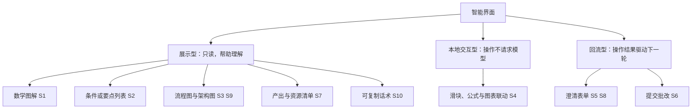
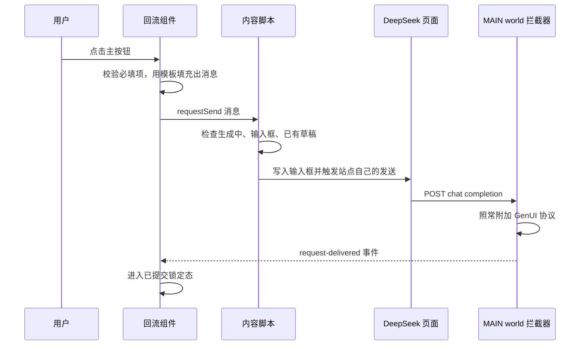

# ChatGPT「智能界面」学习报告（面向 Agent）

> 日期：2026-11-17　｜　来源：用户提供的 10 张 ChatGPT 真实截图（暗色主题）　｜　适用版本：DeepSeek GenUI 0.2.2 之后
>
> 本文是**给后续开发 Agent 读的设计输入**，不是用户文档。阅读顺序：§0 结论 → §3 模式规则 → §4 差距 → §5 一键回流规格 → §7 实施清单。
> 截图本身未入库（含课程名、地理位置等个人信息），本文以文字逐张记录可观察事实；凡属推断的内容均标注「推断」。

---

## 0. 结论速览（TL;DR）

1. ChatGPT 的智能界面分三类：**展示型**（图解、条件列表、流程图、资源清单、可复制话术）、**本地交互型**（滑块驱动公式和图像）、**回流型**（澄清表单、提交批改）。我们的覆盖情况：第二类较强，第一类缺图解、流程图和公式，第三类几乎为空。
2. 回流型的核心交互是：**表单 + 唯一主按钮 → 本地拼出一段自然语言提示词 → 立即作为用户消息发送**。发出的消息是完整、自洽的人话，既带上表单选项，也带上此前对话里的约束；用户气泡中完全可见，不含隐藏 JSON。
3. 推断：提示词模板由模型在生成界面时一并写好（只有它知道对话上下文），前端只负责把选项填进占位符。这是「回流消息质量高」的关键，应该照搬到我们的协议里（§5.3）。
4. 用户已决定采用「点击即发送」，这推翻了本项目「绝不自动发送」的既有原则。§5 给出这项改动的边界、护栏和受影响的文档清单，**实施前必须同步修改隐私说明和商店材料**。
5. 视觉语言高度统一：卡片外框为细描边加大圆角；行之间用分隔线；每行配一个小图标；主按钮是反色的整宽胶囊，末尾带「→」；明确标注「本地计算／不会请求模型」。

---

## 1. 截图逐张记录（事实层）

| # | 内容 | 类型 | 关键可观察细节 |
| --- | --- | --- | --- |
| S1 | 向量子空间图解：坐标平面、直线 y=2x、蓝色向量 v、原点、角标 R² | 展示（数学图解） | 矢量图而非位图；彩色标注直接写在图元旁；卡片底部有一行**图注**（含行内公式），解释图意并纠正常见误解（「不是只有蓝色向量」）；卡片前后都是正文，图解嵌在讲解中间 |
| S2 | 「判断 Subspace 的三个条件」 | 展示（结构化条件列表） | 单卡片，内部 3 行，行间细分隔线；每行左侧一个符号图标（✓ / + / *），右侧是**粗体标题＋中英术语**，下面一行 **LaTeX 公式**；卡片外的正文用于引出主题 |
| S3 | 「整体工作流程」流程图 | 展示（纵向流程图） | 4 个步骤节点，每个节点有图标、序号、标题和一行说明；重点节点用**浅色调底色**区分；节点之间用 ↓ 箭头；底部分成两列，分别是「本地交互（不请求模型）」和「模型交互（发送事件让模型继续思考）」，⇅ 表示双向；**ChatGPT 自己就把交互分成了本地和模型两层** |
| S4 | 交互式二次函数 | 本地交互 | 标题右侧有「本地计算」徽标；居中的 LaTeX 公式**随滑块实时改写**（y = 1x²）；图表带坐标轴、虚线网格、图例和图注「示例曲线由当前滑块参数计算」；滑块一行显示标签和值，两端刻度带**语义**（「-2（向下开口）」「+2（向上开口）」）；下方提示随状态变化（「a 为正，抛物线向上开口。拖动滑块不会重新向大模型发起请求。」）；整宽「重置参数」按钮 |
| S5 | 动态壁纸澄清表单 + 回流消息 | 回流（澄清表单） | 正文里有**来源 chip**（站点名＋“+2”）和带 ↗ 的外链；表单标题是一个问句；第一组为纵向单选（5 项），第二组为横向单选（2 项）；均有默认选中；整宽反色主按钮「查找这种风格的更多动态壁纸 →」；**下方紧接着一条用户消息**：「继续帮我找真实存在且可下载的4K动态壁纸，固定室内视角，透过窗户往外看。主题：卧室窗外雨景；风格：动漫插画。请展示壁纸预览和具体下载页面，优先免费MP4。」 |
| S6 | 「第一轮理解检测」 | 回流（提交批改） | 一张卡片里放 2 道单选题，**无默认选中**；明确写着「暂时不直接给出正确选项」，即判分交给模型而不是本地；附一个可选的自由文本框「简要解释题目 2 的理由（选填）」；主按钮「提交答案并批改」在未作答时呈**禁用灰**；卡片后的正文预告下一阶段的学习路径 |
| S7 | 资源 / 产出清单 | 展示（任务产出状态） | 两行，每行有图标（文件夹 / 笔记）、编号「01 \|」、类别、带 ↗ 的链接标题、一行摘要，行尾是**绿色对勾状态**；用来汇报 Agent 已完成的产出（推断：调用外部工具建页面后的回执） |
| S8 | 高尔夫澄清表单 | 回流（澄清表单） | 两组纵向单选（地点 / 体验类型），都有默认选中，组间用细分隔线；主按钮「查找场馆和价格 →」；卡片下方有**位置上下文 chip**（推断：表单与用户位置信息一同使用） |
| S9 | 技术架构图 | 展示（嵌套架构图） | 外框内的节点自上而下排列；箭头上**带标签**（「已授权的远程连接」）；底部是 2×2 的能力格（图标＋名称）；用排版而非图片表达架构 |
| S10 | 「打电话时直接这样问」 | 展示 + 动作（可复制话术） | 引用框内是第一人称的完整话术；右下角按钮「复制询问话术」；服务于**线下行动**，而不是继续对话 |

S5 的旁证：截图中表单仍显示默认项（高层公寓 / 写实摄影），而已发出的消息是「卧室窗外雨景 / 动漫插画」。推断：消息发出后表单重置或重新渲染，**没有保留已提交的值**。这是一个反例，我们应避免（见 §3.4 R-F6）。

---

## 2. 分类框架



判别规则（给 Agent 用）：
- 操作后**需要模型的新知识或判断**（检索、批改、个性化建议）→ 回流型；
- 操作后**可以在本地确定性地算出结果** → 本地交互型，并明确告诉用户「不会请求模型」；
- 不需要操作 → 展示型，以排版为主，不要硬塞控件。

---

## 3. 设计模式与规则（规范层）

规则编号可在 PR 和测试中直接引用。MUST = 必须，SHOULD = 建议。

### 3.1 布局与嵌入

- **R-L1 MUST**：组件嵌在讲解正文**之间**，前面有引出句，后面有承接句（S1、S2、S6）；不要把整段回答做成一张大卡。
- **R-L2 SHOULD**：一个组件只表达一个意图，标题用问句或「主题名」，放在卡片内的首行，或作为卡片外紧邻的小标题。
- **R-L3 SHOULD**：展示型组件附一行**图注**，解释图意或澄清误解（S1、S4）。

### 3.2 视觉语言

- **R-V1 MUST**：外框为 1px 低对比描边，圆角约 12–16px，背景与页面同色或略深；内部分组靠**分隔线和留白**，不再套框（S2、S6、S7、S8）。这与本项目 D03 的结论一致。
- **R-V2 SHOULD**：列表行使用「左侧图标 + 粗体标题 + 次要说明」三段式（S2、S3、S7）。
- **R-V3 SHOULD**：重点节点用低饱和度的**底色**区分，不用粗边框（S3）。
- **R-V4 MUST**：每张回流卡片**只有一个主按钮**：整宽胶囊，暗色主题下用反色（浅底深字），文案为「动词 + 对象 + →」，并且说明下一轮会做什么（「查找场馆和价格 →」）。次要操作（重置、复制）用描边或幽灵按钮（S4 重置、S10 复制）。
- **R-V5 SHOULD**：数学内容使用真正的公式排版（LaTeX）；公式可以**随状态改写**（S4）。

### 3.3 本地交互

- **R-I1 MUST**：显式告诉用户「本地计算」「不会重新请求模型」，用徽标或提示均可（S4、S3 下栏）。
- **R-I2 SHOULD**：滑块两端写**语义刻度**，而不只是数字（「-2（向下开口）」）。
- **R-I3 SHOULD**：随状态变化的一句话解释，放在控件附近（「a 为正，抛物线向上开口」）。
- **R-I4 MUST**：提供重置（S4）。

### 3.4 回流表单

- **R-F1 MUST**：表单 = 若干字段组 + 一个主按钮。字段类型至少包括单选（纵向/横向）、多选和可选的自由文本（S5、S6、S8）。
- **R-F2 MUST**：默认值策略按意图区分：
  - **澄清 / 偏好类**：预选最常见的选项，让用户一键就能继续（S5、S8）；
  - **测验 / 评估类**：**不预选**，以免暗示答案（S6；本项目已有教训，见 CHANGELOG「checklist 不再被模型预勾选」）。
- **R-F3 MUST**：必填项未完成时主按钮禁用，并说明原因（S6）。
- **R-F4 MUST**：发出的消息是**自洽的自然语言**，包含三部分：
  1. 从对话继承的约束（4K、室内视角）；
  2. 本次的选择（主题、风格）；
  3. 明确的下一步请求和输出要求（展示预览和下载页，优先免费 MP4）。
  禁止只发「我选了 B」这类脱离上下文的短句，也禁止发 JSON。
- **R-F5 MUST**：发出的消息在用户气泡中**完整可见**，与用户手打的消息无异。
- **R-F6 MUST（改进 ChatGPT 的反例）**：提交后表单进入**锁定的「已提交」态**，显示已提交的值并提供「修改后重新提交」；不允许回到默认值，以免与已发消息不一致。
- **R-F7 SHOULD**：测验的批改交给模型时，主按钮写「提交答案并批改」，模板中附上用户的理由文本（S6）。

### 3.5 动作辅助

- **R-A1 SHOULD**：需要用户在线下或别处执行的内容（电话话术、邮件草稿、命令），以引用框加「复制」按钮呈现（S10）。复制后就近给出反馈。
- **R-A2 SHOULD**：已完成的产出用「编号 + 链接 + 摘要 + 状态图标」的清单汇报（S7）。

---

## 4. 与本项目的差距分析

现状参考：`src/protocol/widget/types.ts`（10 种 `w1`）、`src/render/inline/feedback.ts`（回流模板，「绝不自动发送」）、`src/content/followup.ts`（填入输入框）、`src/content/site-adapter.ts`（无发送按钮探针）。代码库中**没有任何公式渲染**（未引用 KaTeX）。

| 模式 | ChatGPT | 本项目现状 | 差距 / 动作 |
| --- | --- | --- | --- |
| 澄清表单 S5 S8 | 多组单选 + 主按钮 → 发送 | 无。`poll` 只展示比例，不回流 | **新增 `w:"form"`**（P0，§5） |
| 提交批改 S6 | 多题、无预选、可选理由、交给模型批改 | `quiz` 单题，**本地即时判分**，不回流 | `quiz` 增加 `grade:"model"` 模式，或者并入 `form`（P0） |
| 一键回流 | 点击即发送 | `checklist` / `compare` / 卡片「继续讨论」**只填入输入框**；模板在 `feedback.ts` 中写死 | 改为「点击即发送」，模板改由模型提供（P0，§5） |
| 本地交互 S4 | 公式、图表、语义刻度、状态解释、「本地计算」徽标 | v4 函数曲线 + 滑块 + 重置都有；**没有公式、语义刻度和显式的「不请求模型」标识**；「透明增强」说明藏在详情里 | 滑块增加 `minLabel` / `maxLabel`；加「本地计算」徽标；评估公式渲染（P1） |
| 条件列表 S2 | 图标 + 标题 + 公式行 | `card.points` 是纯文本项目符号 | `card` 增加 `items[{icon,title,detail}]` 的行式布局（P1） |
| 流程图 S3 S9 | 纵向节点、底色重点、带标签的箭头、分栏 | `timeline` 接近，但没有分支、分栏和箭头标签 | 新增 `w:"flow"`（P2） |
| 数学图解 S1 | 向量、标注、图注 | 折线图只能画函数和散点，不能画向量、标注 | `chart` 增加 `annotations` / `vectors`（P2） |
| 可复制话术 S10 | 引用框 + 复制 | 无 | 新增 `w:"copy"`（P1，成本最低） |
| 产出清单 S7 | 编号、链接、状态 | 无（本项目没有外部工具产出） | 暂不做（N/A） |
| 来源 chip S5 | 引用来源 | 站点原生的联网搜索负责 | 不做 |

---

## 5. 一键回流（点击即发送）规格

### 5.1 产品决定与原则变更

- 用户于 2026-11-17 决定：回流按钮**点击后自动生成提示词并直接发送**，参照 ChatGPT S5。
- 这推翻了既有原则「扩展不会自动发送消息」（见 `README.md`「怎么使用」、`docs/privacy.md`、`docs/store-submission.md`、`src/render/inline/feedback.ts` 文件头）。
- 新原则：**只有用户点击带「→」的主按钮这一明确手势才会发送**；页面加载、状态变化、拖动滑块、勾选都**绝不**触发发送。点击即代表同意发送，发出的内容在气泡中完全可见。

### 5.2 发送链路（推荐方案）



要点：
- **走站点自己的发送路径**：写入输入框（复用 `setNativeValue`），再点击站点的发送按钮或派发 Enter。**不要**在拦截器里伪造请求；这样会话树、重试和编辑等行为都由站点负责。
- `site-adapter.ts` 需新增 `findSendButton(doc)` 探针，并记入诊断（`detection/send-button-missing`）。
- 兜底：找不到发送按钮、按钮禁用、或站点在 N 秒内没有发出请求时，**退回「已填入输入框，请手动发送」**，不重试、不重复写入。

### 5.3 提示词模板：由模型写，本地填充

协议草案（`w1` 新组件）：

```json
{
  "w": "form",
  "id": "wallpaper-pref",
  "title": "你想要哪一种窗外视角？",
  "fields": [
    { "id": "view", "type": "radio", "label": "窗外视角",
      "options": ["高层公寓落地窗，俯瞰城市", "卧室窗外下雨", "木屋窗外是森林雪山"],
      "default": "高层公寓落地窗，俯瞰城市" },
    { "id": "style", "type": "radio", "label": "画面风格", "layout": "inline",
      "options": ["写实摄影", "动漫插画"], "default": "写实摄影" },
    { "id": "extra", "type": "text", "label": "补充要求（选填）", "optional": true }
  ],
  "submit": {
    "label": "查找这种风格的更多动态壁纸",
    "prompt": "继续帮我找真实存在且可下载的4K动态壁纸，固定室内视角。主题：{view}；风格：{style}。{extra?补充：{extra}。}请展示预览和下载页面，优先免费MP4。"
  }
}
```

规则：
- **R-T1**：`submit.prompt` 由模型生成，提示词中要求它「写成用户口吻的完整请求，包含对话里已知的约束」。
- **R-T2**：占位符只允许 `{fieldId}` 和条件段 `{fieldId?…}`。替换值是**纯文本**；不解析 Markdown，也不再做二次模板展开（防止注入）。
- **R-T3**：模型漏写 `prompt`，或模板引用了不存在的字段时，回退到本地通用模板：「关于『{title}』，我的选择是：{label1}：{v1}；{label2}：{v2}。请据此继续。」normalize 层输出 warning，不要整卡失败。
- **R-T4**：长度上限（建议 600 字）超出时截断补充文本，选项部分不截断。
- 测验批改复用同一机制：`fields` 为若干 `type:"choice"`，不写 `default`；`submit.label` 为「提交答案并批改」；`prompt` 中包含 `{q1}`、`{q2}`、`{reason}`。

### 5.4 护栏（全部 MUST）

| 编号 | 护栏 |
| --- | --- |
| G1 | 只有主按钮的 `click` 事件（`isTrusted === true`）会发送；键盘的 Enter 或 Space 激活按钮也算 |
| G2 | 模型**生成中**（`isGenerationActive`）时按钮禁用，并显示「等待当前回答结束」 |
| G3 | 输入框有**用户草稿**时不能覆盖：按钮改为「带入输入框」并给出提示，不直接发送、不丢失任何草稿（**已决**） |
| G4 | 同一组件提交后锁定（R-F6）；「修改后重新提交」需要再点一次。防抖 1 秒，杜绝重复发送 |
| G5 | 引擎开关关闭或「本轮：普通回答」时，回流仍然可用，但不附加协议（沿用拦截器现有逻辑） |
| G6 | 只发送模板填充后的可见文本；**不附带**任何隐藏上下文块或不可见卡片引用（**已决**） |
| G7 | 设置中提供「回流方式：直接发送（默认）/ 仅填入输入框」，记入 `chrome.storage.local` 的既有设置键 |
| G8 | 失败一律降级为填入输入框，并就近以 `role="status"` 反馈，不弹窗 |
| G9 | 首次使用「直接发送」时提示一次（「点击此类按钮会直接发送消息」），状态记入 `chrome.storage.local`，之后不再重复提示（**已决**） |

### 5.5 受影响的既有组件

- `checklist`、`compare`：从「带入输入框」改为主按钮发送；`feedback.ts` 的写死模板降级为 R-T3 的回退模板。
- 卡片「继续讨论」：保留可编辑的预览（它的价值在于可修改的长摘要），预览中的确认按钮改为「发送」，并新增「仅填入」次要按钮。
- `poll`：可选增加 `submit`，让投票结果参与回流。

### 5.6 文档与合规同步（实施的同一个 PR 内完成）

`README.md`（使用说明、隐私与权限）、`docs/privacy.md`、`docs/store-submission.md`（功能描述、审核测试步骤）、Edge 商店的描述文案、`CHANGELOG.md`。商店描述中「不会自动发送」的表述必须改为「仅在你点击发送类按钮时发送」。

---

## 6. 反模式（禁止）

- 一张卡片里有多个主按钮，或者主按钮文案只写「提交」「确定」，看不出下一步会发生什么。
- 回流消息只有「我选 B」或一段 JSON；或者把消息藏起来不显示在气泡里。
- 测验预选答案；或者本地判分之后又把答案泄露给模型的模板。
- 拖动滑块或修改参数时请求模型（违反 R-I1）。
- 提交后表单回到默认值（S5 的反例）。
- 在拦截器中伪造聊天请求来实现发送。
- 为了画图引入远程脚本或运行模型生成的 SVG/HTML（违反 MV3 远程代码政策和本项目的安全边界）；图解必须由受控元素渲染。

---

## 7. 实施清单（建议顺序）

| 阶段 | 内容 | 验收标准 |
| --- | --- | --- |
| P0-a | `site-adapter.findSendButton` + `requestSend` 链路 + 护栏 G1–G9 + 设置项 | 单测覆盖：生成中禁用、草稿保护、首次提示、重复点击、找不到按钮时降级；e2e 模拟页能看到用户气泡出现且只出现一次 |
| P0-b | `w:"form"`：schema、normalize、`FormView`、模板填充、已提交锁定态 | 模板注入测试（值中含 `{x}`、换行、Markdown 时原样输出）；R-T3 回退；亮暗主题和窄栏下的视觉检查 |
| P0-c | `quiz` 增加模型批改模式（或并入 `form`），满足无预选和可选理由 | 未作答时主按钮禁用；模板中包含答案和理由 |
| P0-d | 提示词 v4.2：加入 `form` 用法、R-F2 默认值策略、R-T1 模板写法；按 P0-1 的路线图控制长度 | 用 eval 新增的「澄清」「批改」题测量 form 的生成率和模板自洽率 |
| P0-e | 改造 checklist / compare / 继续讨论；同步 §5.6 的文档 | 原有回流单测更新；文档中不再出现「绝不自动发送」 |
| P1 | `w:"copy"`；滑块的语义刻度；「本地计算」徽标；`card` 行式布局 | 视觉验收对照 S2、S4、S10 |
| P1 | 引入本地 KaTeX 公式渲染（已确认接受约 300 KB 体积增量；必须本地打包，禁止远程资源） | 公式在展示与随滑块改写场景下正确渲染，亮暗主题可读，构建与 `check-dist` 通过 |
| P2 | `w:"flow"`；图表的 `annotations` / `vectors` | 视觉验收对照 S1、S3、S9 |

## 8. 已决问题（2026-11-17 用户拍板）

1. **有草稿时（G3）**：决定改为**「带入输入框」**，不覆盖也不拼接发送。
2. **首次使用「直接发送」提示（G9）**：决定**需要**，在首次使用时提示一次（「点击此类按钮会直接发送消息」）。
3. **公式渲染体积（P1）**：决定**值得**增加约 300 KB 体积以引入本地 KaTeX 公式渲染，不采用 Unicode 近似方案。
4. **不可见卡片引用（G6）**：决定**不需要**，回流消息保持纯可见文本，不引入隐藏上下文块或额外剥离成本。
