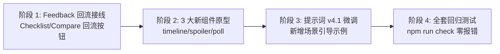

# GenUI v0.2.1 功能目标与探索方向设计文档

> **版本定位**：v0.2.1 探索版（微交互回路与组件表达扩充）  
> **文档属性**：本地规划备忘（不纳入 Git 跟踪）  
> **前置基础**：v0.2.0 已完成内联 `w1` 协议、7 种原子组件、正文穿插排版及跨组件状态总线。

---

## 目录
- [GenUI v0.2.1 功能目标与探索方向设计文档](#genui-v021-功能目标与探索方向设计文档)
  - [目录](#目录)
  - [1. 探索背景与核心价值](#1-探索背景与核心价值)
  - [2. 功能目标一：作答一键回流（Feedback Loop）](#2-功能目标一作答一键回流feedback-loop)
    - [2.1 核心机制与用户链路](#21-核心机制与用户链路)
    - [2.2 具体场景落地](#22-具体场景落地)
      - [A. Checklist 进度回流](#a-checklist-进度回流)
      - [B. Compare 方案选定回流](#b-compare-方案选定回流)
  - [3. 功能目标二：新组件形态扩充](#3-功能目标二新组件形态扩充)
    - [3.1 时间线组件 (`timeline`)](#31-时间线组件-timeline)
    - [3.2 折叠思考块 (`spoiler`)](#32-折叠思考块-spoiler)
    - [3.3 倾向投票器 (`poll`)](#33-倾向投票器-poll)
  - [4. 协议与宽容解析规范 (Draft)](#4-协议与宽容解析规范-draft)
  - [5. 技术实现路线与质量验收](#5-技术实现路线与质量验收)
  - [6. v0.2.2 目标：GenUI 工具栏折叠面板](#6-v022-目标genui-工具栏折叠面板)
  - [7. v0.2.2 目标：网络层静默注入（全链路无感增强）](#7-v022-目标网络层静默注入全链路无感增强)

---

## 1. 探索背景与核心价值

在 v0.2.0/v0.2.1 中，DeepSeek 已经成功实现了在自然长文中自由穿插渲染小组件。用户反馈体验非常惊艳，但也催生了两个更高维度的体验诉求：

1. **从“单向查看”走向“双向对话回路”**：用户在组件中完成了交互（例如 Checklist 勾选了一半、Compare 决定选用某方案），往往渴望**就当前交互结果继续与 AI 深入交流**，避免手动复制或重复打字；
2. **更丰富的情境化叙事组件**：除了目前的数据/参数/对比/问答，在技术演进、教学思考和方案决策场景中，需要更具场景针对性的组件（时间线、防剧透思考折叠、倾向投票）。

---

## 2. 功能目标一：作答一键回流（Feedback Loop）

### 2.1 核心机制与用户链路
当用户完成内联小组件的交互动作后，组件自动提供一个**无侵入的轻量级动作入口**，点击后将当前上下文精准带入 DeepSeek 输入框（沿用扩展已有的 `followup` / `fillContinueIntoInput` 机制，绝不自动发送，保障用户掌控权）。

### 2.2 具体场景落地

#### A. Checklist 进度回流
- **触发时机**：清单勾选部分或全部后，底部提供轻量操作：`📋 将未完成任务带入下一步规划`；
- **回流填充模板**：
  ```text
  【任务跟进】
  已完成（2/4）：1. 单元测试、2. 代码审查
  待完成（2/4）：3. 性能基准测试、4. 灰度发布
  请帮我针对以上未完成的步骤，制定详细的执行步骤与注意事项。
  ```

#### B. Compare 方案选定回流
- **触发时机**：对比卡中，用户可在感兴趣的方案列下方点击：`👉 采用此方案继续细化`；
- **回流填充模板**：
  ```text
  【方案选型确认】
  在对比方案中，我决定采用【方案B】。请帮我细化该方案的落地架构图与第一阶段实施计划。
  ```

---

## 3. 功能目标二：新组件形态扩充

### 3.1 时间线组件 (`timeline`)
- **使用场景**：架构演化历史、故障排查时序、项目迭代里程碑、异步工作流步骤。
- **协议草案 (`w1`)**：
  ```json
  {
    "w": "timeline",
    "title": "React 架构演进路线",
    "items": [
      { "time": "2013", "title": "React 开源", "desc": "引入虚拟 DOM 与单向数据流" },
      { "time": "2018", "title": "Hooks 发布", "desc": "函数式组件与逻辑复用革命", "highlight": true },
      { "time": "2024", "title": "React 19", "desc": "Actions、Server Components 与编译器生态" }
    ]
  }
  ```
- **视觉要点**：垂直细实线贯穿、圆点指示器（当前/高亮节点为亮色并带呼吸外晕）、时间标签等宽对齐。

### 3.2 折叠思考块 (`spoiler`)
- **使用场景**：互动式教学答疑、面试题自测（“先自己思考 30 秒，不要直接看答案”）、长段推导细节折叠。
- **协议草案 (`w1`)**：
  ```json
  {
    "w": "spoiler",
    "summary": "思考题：为什么此处不能直接使用 localStorage？",
    "hint": "提示：考虑多标签页同步与跨域隔离",
    "content": "因为在多标签页高并发写入时，localStorage 缺乏事务锁，容易产生覆写；且受同源策略限制无法在 Service Worker 内访问。"
  }
  ```
- **视觉要点**：默认收起、微透背景、折叠展开平滑过渡动画，点击“展开思考与解析”揭示内容。

### 3.3 倾向投票器 (`poll`)
- **使用场景**：技术选型倾向、最佳实践调研、互动式观点表达。
- **协议草案 (`w1`)**：
  ```json
  {
    "w": "poll",
    "question": "在当前团队规模下，你更倾向哪种状态管理方案？",
    "options": [
      { "id": "zustand", "label": "Zustand (轻量简单)", "ratio": 58 },
      { "id": "redux", "label": "Redux Toolkit (规范严格)", "ratio": 24 },
      { "id": "context", "label": "原生 Context + Reducer", "ratio": 18 }
    ]
  }
  ```
- **视觉要点**：未投票前是选项按钮，点击投票后立即变为百分比填充条与高亮对勾，极简动效。

---

## 4. 协议与宽容解析规范 (Draft)

在 `src/protocol/widget/` 中扩展：
1. **类型扩展**：
   - `export type WidgetKind = ... | 'timeline' | 'spoiler' | 'poll';`
2. **宽容补全层 (`normalize.ts`)**：
   - `timeline`：若缺少 `time` 字段，自动按数组序号推导为步骤 `Step 1/2/3`；
   - `spoiler`：若只有 `text` 字段，自动将其作为 `content`，`summary` 缺省为“点击查看推导细节”；
   - `poll`：若缺少 `ratio`，投票后默认按均分比例呈现动态条。

---

## 5. 技术实现路线与质量验收



- **验证指标**：
  - 新增组件单测覆盖率 100%；
  - 回流填充对草稿具有非破坏性（追加不覆盖、不触发自动发送）；
  - 生产包体积控制在合理增量（< 30KB）。

---

## 6. v0.2.2 目标：GenUI 工具栏折叠面板

- **收起态**：只显示 GenUI 状态胶囊（如 `GenUI 已开启`）和右侧展开箭头。箭头独立控制面板，避免误触 GenUI 开关。
- **展开态**：在状态胶囊下方显示右对齐的圆角面板，沿用深色样式。三行依次为「本轮」模式选择（如「自动适配」）、「查看增强说明」和「本地诊断」。顶部箭头向上，再点一次收起。

---

## 7. v0.2.2 目标：网络层静默注入（全链路无感增强）

彻底告别在聊天输入框中经过 700ms 防抖可见追加大段协议文本的旧方案，改为**网络层双向拦截 + DOM 兜底**的无感架构：

- **双向网络拦截（`MAIN` World Fetch Hook）**：
  - **发请求静默注入**：拦截发往 DeepSeek 聊天生成接口（如 `POST /api/v0/chat/completion`）的请求，在 `enabled === true` 且非 `plain` 模式下，每轮在 JSON Payload 的用户消息末尾自动拼接完整 GenUI 协议；输入框始终保持 100% 原生纯净，发出后单轮模式（`tool` / `plain`）自动重置回 `auto`。
  - **读历史自动剥离**：拦截历史消息拉取接口（如 `GET /api/v0/chat/history_messages`）的响应，在交付前端状态前自动剥离消息尾部的 `〔GenUI ...〕...〔GenUI 增强说明结束〕` 区间，配合 DOM 层兜底清洗，确保**查看气泡、点击复制、编辑旧消息**全程看不到协议尾注。
- **无感化错误修复**：
  - 点击卡片下方的「生成修复请求」时，输入框仅填入一句简短修复提示（如 `请修复上一条回答中的 GenUI 界面代码块格式错误`），详细的协议报错路径、期望格式与原始片段交由网络拦截层在发送时静默挂载。
- **浮标状态与草稿状态机精简**：
  - 移除监听 `<textarea>` 的防抖追加与草稿比对状态机（废弃 `scheduled` / `appended` / `dismissed` / `edited` 等草稿态），保留浮标开关、三档模式切换及协议只读预览，状态文案简化为「发送时静默生效」。

> **验收前提（2026-11-10 复核补充）**：历史与气泡剥离按「完整协议正文逐字一致」或「带 FNV-1a 校验码的修复详情块」即时判断，不保存消息 id、索引或本地记录；正文被站点改写、被用户编辑或只引用首尾标记时保留原文。用户把自己消息末尾逐字粘贴完整协议或合法校验码的修复块属于已接受的极端情形。真实 DeepSeek 上的编辑、重试与刷新链路仍待真机取证，因此「查看气泡、点击复制、编辑旧消息全程看不到协议」按尽力而为理解。

